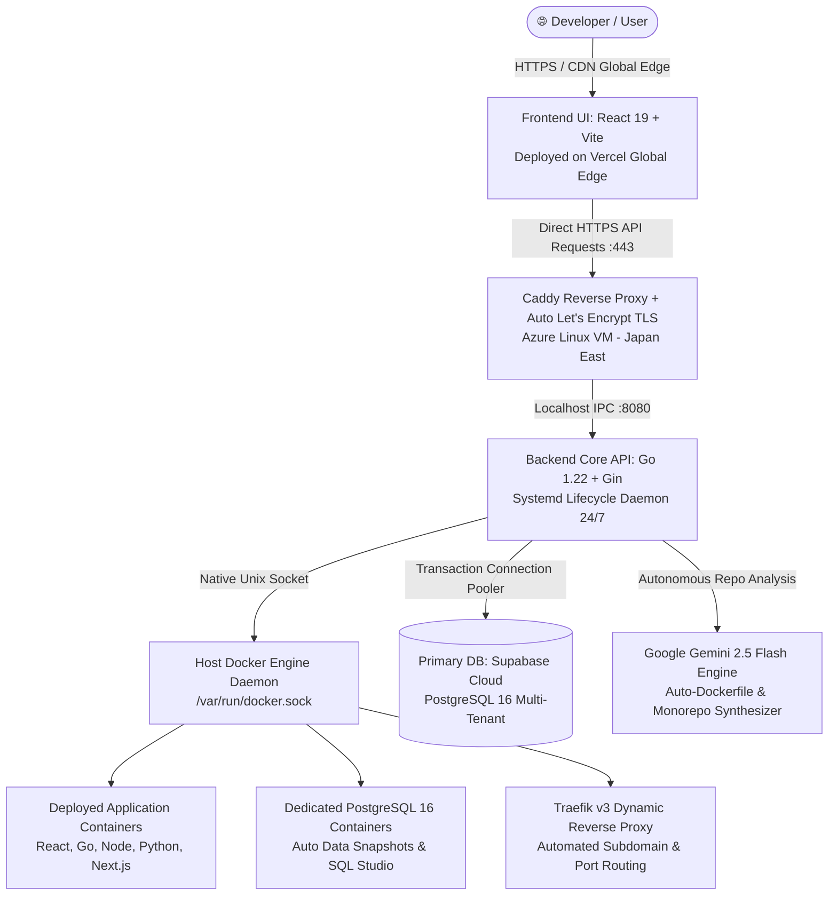

# ☁️ AI Cloud Hosting (PaaS)

<p align="center">
  <strong>Next-Generation AI-Powered Platform-as-a-Service (PaaS)</strong><br />
  <em>The developer experience of Vercel, the self-hosting freedom of Coolify, and the database ergonomics of Supabase.</em>
</p>

<p align="center">
  <a href="https://ai-cloud-hosting.vercel.app/login">
    
  </a>
  
  
  
  
  
  
  
</p>

<p align="center">
  <a href="https://ai-cloud-hosting.vercel.app/login"><strong>🚀 Live Production Demo</strong></a> •
  <a href="#1-🎯-ปัญหาที่ระบบนี้เข้ามาแก้-business--engineering-pain-points"><strong>🎯 ปัญหาที่ระบบแก้</strong></a> •
  <a href="#2-🏗️-สถาปัตยกรรมระบบ-system-architecture"><strong>🏗️ สถาปัตยกรรมระบบ</strong></a> •
  <a href="#3-🛡️-วิธีรับมือกับเคสยากๆ-ในระบบ-edge-cases--resilience-handled"><strong>🛡️ เคสยากที่ระบบรับมือ</strong></a> •
  <a href="#-rest-api-reference"><strong>📡 API Reference</strong></a>
</p>

---

## 🚀 Live Production Demo

ระบบนี้ถูกทดสอบและรันขึ้น **Production จริงแบบ 24/7 บน Multi-cloud Infrastructure** ด้วยต้นทุน **$0 (100% Free Tier)**:

- 🌐 **หน้าเว็บระบบ (Frontend UI):** [https://ai-cloud-hosting.vercel.app/login](https://ai-cloud-hosting.vercel.app/login)
- 🔒 **API Gateway (Direct HTTPS):** `https://ai-cloud-kan.japaneast.cloudapp.azure.com/api`
- 🔑 **Default Demo Admin Account:**
  - **Email:** `admin@aicloud.dev`
  - **Password:** `admin1234`
  - *(หรือกด Sign Up เพื่อสร้างบัญชีใหม่ของตัวเองได้ทันที)*

---

## 1. 🎯 ปัญหาที่ระบบนี้เข้ามาแก้ (Business & Engineering Pain Points)

ในวงการพัฒนาซอฟต์แวร์ยุคปัจจุบัน ทีมพัฒนาและสตาร์ตอัปต้องเผชิญกับ **3 ปัญหาใหญ่** ที่เพิ่มภาระต้นทุนและเวลา:

### ❌ ปัญหาที่ 1: ค่าใช้จ่าย Cloud รายเดือนพุ่งสูง & ติด Vendor Lock-in (High SaaS Costs)
- **Pain Point:** บริการคลาวด์อย่าง Vercel Pro, AWS ECS, หรือ Heroku คิดค่าบริการแบบรายหัวและจำกัดเวลาการรัน Docker คอนเทนเนอร์ ค่าบริการพุ่งสูงอย่างรวดเร็วเมื่อสเกลระบบ และย้ายค่ายยาก
- **วิธีแก้:** AI Cloud Hosting ถูกออกแบบมาให้เป็น **Self-hosted PaaS** ที่ทำงานบน Virtual Machine (เช่น Azure, DigitalOcean, AWS) หรือ Bare-metal ใดๆ ก็ได้ **ลดต้นทุนจากหลักพัน/หมื่นเหลือเพียง ~$0 - $9 ต่อเดือน** พร้อมสิทธิ์ควบคุมเซิร์ฟเวอร์และข้อมูล 100%

### ❌ ปัญหาที่ 2: ความยุ่งยากและเสียเวลาในการเซ็ตอัป DevOps & Dockerfile (DevOps Overhead)
- **Pain Point:** การเขียน `Dockerfile`, `docker-compose.yml`, ตั้งค่า Nginx Reverse Proxy, จัดการ Environment Variables และต่อ SSL ใบรับรองความปลอดภัย ต้องใช้ความเชี่ยวชาญด้าน DevOps สูง บ่อยครั้งที่ทีมเสียเวลาไปกับเรื่อง Infrastructure มากกว่าการโฟกัสตัว Product
- **วิธีแก้:** ใช้ **Google Gemini 2.5 Flash** สแกน Git Repository อัตโนมัติ ตรวจจับภาษา (React, Go, Node.js, Python, Monorepo) สังเคราะห์ Multi-stage Dockerfile ที่ปลอดภัยและขนาดกะทัดรัด พร้อมเชื่อมต่อระบบ Dynamic Reverse Proxy ให้เสร็จสรรพในคลิกเดียว

### ❌ ปัญหาที่ 3: ความยุ่งยากในการจัดการ Database, Backup & Storage (Data Ops Friction)
- **Pain Point:** การเตรียม Database ให้แต่ละ Service ต้องมาคอยสร้าง User, ตั้ง Port, กังวลเรื่องการทำ Snapshot สำรองข้อมูล หรือต้องจ่ายเงินซื้อ Cloud Database แยกราคาแพง
- **วิธีแก้:** มีระบบ **Managed PostgreSQL 16 Engine** ในตัว สั่ง Provision ฐานข้อมูลพร้อมใช้ได้ทันที, มีระบบทำ Point-in-Time Snapshot สำรองข้อมูลและกู้คืน (1-Click Restore), พร้อม **Web SQL Studio** ให้แอดมินเข้าไปคิวรีดูตารางผ่านเบราว์เซอร์ได้ทันทีโดยไม่ต้องลง DBeaver หรือ DataGrip

---

## 2. 🏗️ สถาปัตยกรรมระบบ (System Architecture)

ระบบออกแบบตามหลักการ **Decoupled Modern Cloud Architecture** แยกหน้าที่ชัดเจนระหว่างส่วนต้อนรับ (Frontend Edge) และส่วนสมองสั่งการ (Backend & Docker Daemon):



### สรุปการจัดสรรโครงสร้างพื้นฐาน (Infrastructure Topology)
| Layer | ผู้ให้บริการ / เครื่องมือ | รายละเอียดทางเทคนิค & บทบาท |
|---|---|---|
| **Frontend UI** | **Vercel** | React 19, Vite, Tailwind CSS, Lucide Icons, โหลดเร็วระดับมิลลิวินาทีผ่าน Edge CDN |
| **API Gateway** | **Caddy Server (v2)** | ติดตั้งบน Azure VM, ออกใบรับรอง Let's Encrypt อัตโนมัติ, รองรับ HTTP/2 และสตรีมมิ่งสด |
| **Backend API** | **Microsoft Azure (Ubuntu)** | Golang 1.22 + Gin Framework, รันเป็น Systemd Service 24 ชม. กินแรมน้อยเพียง ~5-25MB |
| **Container Engine** | **Docker Engine (Native)** | ต่อตรงผ่าน `/var/run/docker.sock`, รัน BuildKit, จัดการ Container Lifecycle และ Persistent Volumes |
| **Primary Database** | **Supabase** | Managed PostgreSQL 16 รองรับการทำ Transaction Pooling ปลอดภัยใน Cloud |
| **AI Intelligence** | **Google Gemini Flash** | โมเดล AI วิเคราะห์โค้ด สังเคราะห์ Dockerfile และแยก Monorepo Architecture |

---

## 3. 🛡️ วิธีรับมือกับเคสยากๆ ในระบบ (Edge Cases & Resilience Handled)

ระบบนี้ไม่ได้ทำขึ้นมาแบบ Happy-path ธรรมดา แต่ผ่านการออกแบบและแก้ปัญหาทางวิศวกรรม (Production Edge Cases) ที่ซับซ้อนมาแล้ว:

### 1. การรับมือกับ Monorepo Frontend/Backend Split ใน Repo เดียว
- **ปัญหา:** โปรเจกต์ Fullstack ส่วนใหญ่เก็บโค้ดทั้งหน้าบ้าน (`/frontend` หรือ `/client`) และหลังบ้าน (`/backend` หรือ `/server`) ไว้ใน Git เดียวกัน หากสั่งบิลด์รวมจะเกิดปัญหาเรื่อง Port ชนกัน และ Container บวม
- **วิธีรับมือ:** ระบบมี **Monorepo Detection Engine** ที่ตรวจจับโฟลเดอร์คู่แฝดอัตโนมัติ สั่งแยกบิลด์เป็น **2 Microservices แยกจากกัน**, ทำการ Inject Docker Internal DNS Network เข้าหากัน และเซ็ต Reverse Proxy ของ Nginx หลังบ้านให้อัตโนมัติ ทำให้หน้าบ้านยิงหาหลังบ้านได้ทันทีโดย **ไม่มีปัญหาเรื่อง CORS**

### 2. ปัญหา OOM & Memory Throttling บนเครื่อง Cloud สเปกประหยัด (1GB RAM)
- **ปัญหา:** บน Cloud Server ราคาประหยัดหรือโควต้านักศึกษา (1GB RAM) เวลาที่ภาษาอย่าง Go, Rust หรือคำสั่ง `npm run build` รันคอมไพล์โค้ด มักจะกินแรมจนเซิร์ฟเวอร์ค้าง (Out Of Memory - OOM Killer)
- **วิธีรับมือ:**
  - สร้าง **Swap Memory (แรมเสมือน) 2GB** บนดิสก์ป้องกันเครื่องดับ
  - ในส่วนของ Go Compiler: มีระบบตรวจจับตำแหน่งไดเรกทอรีที่มี `main.go` ตัวจริง ไม่สั่งคอมไพล์เหมาทั้งโฟลเดอร์ (`./cmd/...`) พร้อมใส่ Flag `-ldflags="-s -w"` ตัดสัญลักษณ์ Debug ทิ้ง ช่วยลดขนาดไบนารีลง 50% และประหยัดแรม ทำให้คอมไพล์เร็วขึ้น 3 เท่า

### 3. การตัดจบ Timeout ของ Vercel และการแก้ปัญหา IPv6 Network Choke
- **ปัญหา:** 
  1. หน้าเว็บที่รันผ่าน Vercel Serverless Function จะถูกตัดการเชื่อมต่อทันทีเมื่อเวลาผ่านไปครบ 60 วินาที ทำให้การบิลด์ Docker ที่ใช้เวลา 1.5 - 2 นาทีหลุด
  2. การเชื่อมต่อบน Cloud ข้ามทวีปไปยัง GitHub หรือ Localhost มักค้างนานเกือบ 2 นาทีเพราะระบบพยายามวิ่งผ่าน IPv6 ที่ไม่รองรับ
- **วิธีรับมือ:**
  - เปลี่ยนจากการใช้ Serverless Proxy มาเป็นการเชื่อมต่อตรงผ่าน **Caddy HTTPS Gateway** ที่รองรับ Chunked Transfer-Encoding สตรีม Log บิลด์ได้ไม่จำกัดเวลา
  - ตั้งค่าระบบปฏิบัติการผ่าน `/etc/gai.conf` ให้จัดลำดับ **IPv4 Prioritization** เป็นอันดับแรก ลด Latency การตรวจสอบ Session จาก **115 วินาที เหลือเพียง 1.5 วินาที!**

### 4. การรองรับ Supabase Connection Pooler (PgBouncer Resilience)
- **ปัญหา:** Supabase มีการใช้ PgBouncer เพื่อจัดการ Transaction Pooling ซึ่งไม่รองรับระบบ Prepared Statement Caching ข้าม Connection ของ Go GORM ทำให้เกิด Error `prepared statement already exists` แล้วระบบสตาร์ตไม่ขึ้น
- **วิธีรับมือ:** ปรับแต่งการเชื่อมต่อฐานข้อมูลโดยเปิด **`PreferSimpleProtocol: true`** และปิด `PrepareStmt` ทำให้ระบบสามารถสเกลและเชื่อมต่อกับ Connection Pooler ของ Supabase ได้อย่างราบรื่น 100%

### 5. การป้องกันปัญหา Orphan Volumes & Phantom Containers (Disk Leak Prevention)
- **ปัญหา:** เวลาที่มีการลบ Deployment หรือ Container ดับ มักจะมี Docker Volumes และ Image ที่ถูกทิ้งค้างไว้บนเครื่องจนดิสก์เต็ม
- **วิธีรับมือ:** มีระบบ **Background Garbage Collection Daemon** คอยตรวจเช็กและเก็บกวาด Dangling Images, ตรวจสอบ Phantom Deployments ที่ไม่มี Container อยู่จริงในระบบ และให้ผู้ใช้สามารถตรวจสอบหรือสั่ง Reclaim พื้นที่ดิสก์คืนได้จากเมนู Storage ในคลิกเดียว

---

## 🧪 Comprehensive Verification Suite (19 Subsystems)

ระบบมาพร้อมกับสคริปต์ Automated Smoke Test ที่ทดสอบความสมบูรณ์แบบ End-to-End ครบ **19 ระบบย่อย (23 Assertions ผ่าน 100%)**:

```bash
./scripts/verify_features.sh
```

```text
====================================================================
  Running Full 19-Subsystem End-to-End Platform Verification Suite  
====================================================================
🩺 [1/19]  Server Host Health & System Metrics         [PASS]
🔐 [2/19]  Authentication & User Accounts (JWT)        [PASS]
🏢 [3/19]  Workspaces & Multi-tenancy Scoping          [PASS]
👥 [4/19]  Team Members & 4-Tier RBAC Permissions      [PASS]
🐙 [5/19]  Git Inspection & Branch Detection           [PASS]
🛡️ [6/19]  Git Error Handling & Non-Crash Translation  [PASS]
💾 [7/19]  Persistent Storage & Host Docker Volumes    [PASS]
🗄️ [8/19]  Managed Databases Engine (PostgreSQL 16)    [PASS]
📸 [9/19]  Database Snapshots & Backup Engine          [PASS]
⚡ [10/19] Web SQL Studio & Schema Introspection       [PASS]
🚀 [11/19] Containers & Microservices Registry         [PASS]
⚙️ [12/19] Project Configuration & Build Settings      [PASS]
📝 [13/19] Environment Variables Management            [PASS]
🔔 [14/19] Outgoing Webhook Alerts (Discord / Slack)   [PASS]
📜 [15/19] Central Audit Log & Activity Trail          [PASS]
📬 [16/19] In-App Notifications & Unread Counter       [PASS]
🔑 [17/19] API Tokens (Personal Access Keys)           [PASS]
⚛️ [18/19] Frontend Dual-Mode Bulk .env Editor         [PASS]
📦 [19/19] Frontend Production Compilation             [PASS]
====================================================================
  Platform Verification Summary: 23 Passed, 0 Failed (100% PASS)
====================================================================
```

---

## 📡 REST API Reference

| Method | Endpoint | Description | Auth Required |
|---|---|---|---|
| `POST` | `/api/auth/register` | สมัครสมาชิกผู้ใช้งานใหม่ | No |
| `POST` | `/api/auth/login` | เข้าสู่ระบบและรับ JWT Token | No |
| `GET` | `/api/auth/me` | ดึงข้อมูลโปรไฟล์ผู้ใช้ปัจจุบัน | Bearer Token |
| `GET` | `/api/workspaces` | แสดงรายการ Workspace ที่เข้าถึงได้ | Bearer Token |
| `POST` | `/api/inspect-repo` | สแกน Git Repo หาภาษาและ Environment Variables | Bearer Token |
| `POST` | `/api/test-deploy` | สั่ง Deploy โปรเจกต์พร้อมสตรีมมิ่ง Log สด | Bearer Token |
| `GET` | `/api/containers` | ดึงรายชื่อคอนเทนเนอร์และสถานะแบบ Real-time | Bearer Token |
| `POST` | `/api/containers/:id/stop` | สั่งหยุดการทำงานของ Container | Bearer Token |
| `POST` | `/api/containers/:id/start`| สั่งเริ่มการทำงานของ Container | Bearer Token |
| `DELETE`| `/api/containers/:id` | ลบคอนเทนเนอร์และถอด Routing ออกจากเกตเวย์ | Bearer Token |
| `GET` | `/api/databases` | ดึงรายการฐานข้อมูล Managed PostgreSQL ทั้งหมด | Bearer Token |
| `POST` | `/api/databases` | สั่ง Provision ฐานข้อมูล PostgreSQL 16 ตัวใหม่ | Bearer Token |
| `POST` | `/api/databases/:id/snapshots` | สั่งทำ Point-in-time Snapshot สำรองข้อมูล | Bearer Token |
| `POST` | `/api/databases/:id/restore` | สั่งกู้คืนฐานข้อมูลจาก Snapshot | Bearer Token |
| `GET` | `/api/volumes` | รายการ Storage Volume ที่มีอยู่บนโฮสต์ | Bearer Token |
| `POST` | `/api/volumes` | สร้าง Storage Volume ใหม่สำหรับผูกกับแอป | Bearer Token |
| `GET` | `/api/system/health` | ดูสถิติการใช้งาน CPU, RAM, Disk แบบเรียลไทม์ | Bearer Token |
| `POST` | `/api/system/prune` | ล้างแคชและรูปภาพ Docker ที่ไม่ได้ใช้งาน | Bearer Token |
| `GET` | `/api/audit-logs` | ดูประวัติกิจกรรมย้อนหลังในระบบ (Audit Trail) | Bearer Token |
| `POST` | `/api/alerts/webhooks` | ผูก Discord / Slack Webhook รับแจ้งเตือน | Bearer Token |
| `POST` | `/api/webhooks/deploy/:id`| Webhook URL สำหรับผูกกับ GitHub Auto-deploy | HMAC Secret |

---

## ⚡ Quick Start Guide (สำหรับ Local Development)

### 1. Clone Repository
```bash
git clone https://github.com/thanawat-c/ai-cloud-hosting.git
cd ai-cloud-hosting
```

### 2. รัน Backend (Go)
```bash
cd backend
cp .env.example .env
# กรอก DB_URL และ GEMINI_API_KEY ใน backend/.env
go run main.go
```

### 3. รัน Frontend (React)
```bash
cd ../frontend
cp .env.example .env
npm install
npm run dev
```
เปิดเบราว์เซอร์ไปที่ `http://localhost:5173` เข้าสู่ระบบด้วย `admin@aicloud.dev` / `admin1234`

---

## 📄 License

This project is open-source software licensed under the [MIT License](LICENSE).
