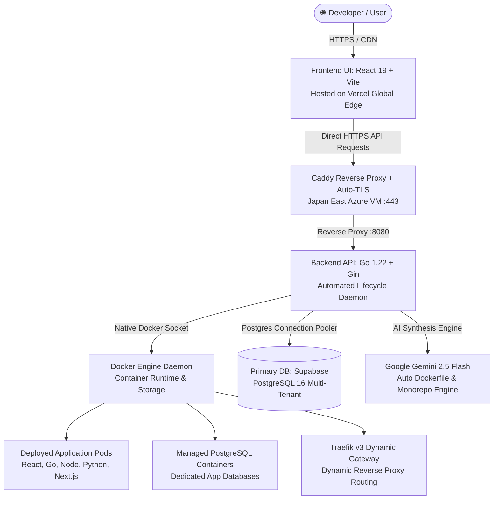

# ☁️ AI Cloud Hosting (PaaS)

<p align="center">
  <strong>Next-Generation AI-Powered Platform-as-a-Service (PaaS)</strong><br />
  <em>The developer experience of Vercel, the self-hosting freedom of Coolify, and the database ergonomics of Supabase.</em>
</p>

<p align="center">
  <a href="https://ai-cloud-hosting.vercel.app/login">
    
  </a>
  
  
  
  
  
  
  
</p>

<p align="center">
  <a href="https://ai-cloud-hosting.vercel.app/login"><strong>🚀 Live Production Demo</strong></a> •
  <a href="#-architecture"><strong>🏗️ Architecture</strong></a> •
  <a href="#-key-features"><strong>✨ Key Features</strong></a> •
  <a href="#-quick-start-guide"><strong>⚡ Quick Start</strong></a> •
  <a href="#-rest-api-reference"><strong>📡 API Reference</strong></a> •
  <a href="#-security-and-best-practices"><strong>🔒 Security</strong></a>
</p>

---

## 🌐 Live Production Demo

The entire platform is deployed and running **24/7 on multi-cloud infrastructure** with zero downtime:

- **Frontend URL:** [https://ai-cloud-hosting.vercel.app/login](https://ai-cloud-hosting.vercel.app/login)
- **API Gateway (HTTPS):** `https://ai-cloud-kan.japaneast.cloudapp.azure.com/api`
- **Default Admin Demo Account:**
  - **Email:** `admin@aicloud.dev`
  - **Password:** `admin1234`
- *(Or register your own new account directly from the Sign Up page)*

> 💡 **Cost Efficiency:** Running 100% free ($0/month) utilizing student cloud benefits (GitHub Student Developer Pack, Microsoft Azure for Students, Supabase Managed PostgreSQL Free Tier, and Vercel Global Edge Network).

---

## 📖 Overview

**AI Cloud Hosting** is an open-source, developer-first **Platform-as-a-Service (PaaS)** built for seamless self-hosting on cloud virtual machines (Azure, AWS, DigitalOcean) or on-premise bare-metal servers. It automates container builds, multi-framework monorepo deployments, managed database provisioning, automated snapshot backups, and persistent storage — completely eliminating hardcoded environments and vendor lock-in.

Powered by **Google Gemini 2.5 Flash**, the platform autonomously inspects raw Git repositories, identifies project architectures, synthesizes production-grade Dockerfiles, and manages dynamic Traefik reverse-proxy routing without requiring manual `docker-compose.yml` boilerplate from the developer.

---

## 🏗 System Architecture

The platform follows a decoupled, resilient architecture designed for high availability and zero-touch continuous deployment:



### Infrastructure Topology
| Component | Hosting Provider | Specifications & Role |
|---|---|---|
| **Frontend UI** | **Vercel** | Global Edge CDN, React 19 SPA, zero-downtime deployments |
| **Backend API** | **Microsoft Azure** | Standard B-series Ubuntu 24.04 LTS (Japan East), Go daemon |
| **Container Engine** | **Azure Host Docker** | Native `/var/run/docker.sock`, multi-stage builds, isolated bridges |
| **Primary Database** | **Supabase** | Managed PostgreSQL 16, transaction pooling via PgBouncer |
| **TLS & Gateway** | **Caddy Server** | Automatic Let's Encrypt SSL certificates, HTTP/2, reverse proxy |

---

## ✨ Key Features & Capabilities (The 19 Subsystems)

### 1. 🤖 AI-Powered Intelligent Deployments
- **Zero-Config Monorepo & Single-Repo Support:** Intelligently detects React, Vite, Next.js, Nuxt 3, Vue, Node.js, Golang, Python, FastAPI, and more. Automatically provisions separate microservices for frontend and backend in fullstack repositories.
- **Dynamic Dockerfile Synthesis:** Gemini AI inspects dependencies and synthesizes optimized, multi-stage production Dockerfiles and Nginx reverse proxies on the fly.
- **Git Push Webhooks & Auto-Deploy:** Full GitHub push webhook integration (`/api/webhooks/deploy/:id`) with HMAC SHA-256 signature verification for zero-touch CI/CD.
- **Rollback Engine & Release History:** Immutable deployment release history with instant zero-downtime rollback to any prior release version.

### 2. 🗄️ Managed Databases & Web SQL Studio
- **On-Demand PostgreSQL 16 Instances:** Provision isolated database containers in seconds with automatic port allocation and secure credentials.
- **Automated Point-in-Time Snapshots:** Create binary database dumps (`.dump` / `.sql`) on demand, download backups, or perform one-click state restoration.
- **Built-in Web SQL Studio:** Native schema introspection, table structure inspection, and interactive SQL query runner right inside the browser.

### 3. 💾 Persistent Storage & Docker Volumes
- **Host-Level Volume Provisioning:** Manage Docker volumes directly from the UI with real-time mount tracking and container association.
- **Host Reclamation:** Detect orphaned storage volumes and safely prune or reclaim host disk space.

### 4. 🏢 Multi-Tenancy & Workspaces
- **Workspace Scoping:** All resources (deployments, databases, volumes, tokens) are strictly isolated by `X-Workspace-Id`.
- **4-Tier RBAC:** Granular role-based access control (`Owner`, `Admin`, `Member`, `Viewer`) with audit trail logging for security compliance.

### 5. 🔔 Webhooks & Alerting Engine
- **Discord & Slack Integrations:** Register webhooks to receive rich, color-coded embed notifications when deployments start, succeed, or fail.
- **Toggle & Test Endpoints:** Test webhook connectivity directly from the UI with zero broken image links.

### 6. 🎨 Developer Experience (Vercel-Inspired UI)
- **Minimalist Dark Aesthetics:** Sleek `#000000` / `#0a0a0a` theme with high-contrast typography and subtle ambient accents.
- **Real-Time Log Streaming:** Live server-sent build and deployment logs with intelligent root-cause error extraction.
- **Bulk `.env` Management:** Key-value table editor with 1-click database connection injection (`DATABASE_URL`).

---

## 🛠 Tech Stack

| Layer | Technologies & Tools |
|---|---|
| **Frontend** | React 19, Vite 8, Tailwind CSS, Lucide Icons, Sonner Toasts |
| **Backend** | Go (Golang) 1.22+, Gin Web Framework, GORM ORM, Docker Go SDK, JWT v5, gopsutil |
| **Database** | PostgreSQL 16 (Supabase Cloud + Managed Docker Containers) |
| **Web Server / TLS** | Caddy v2 (Automatic HTTPS / Let's Encrypt), Traefik v3 (Container Gateway) |
| **AI Inference** | Google Gemini 2.5 Flash API |
| **Hosting** | Vercel (Frontend), Microsoft Azure Virtual Machines (Backend & Docker Engine) |

---

## ⚡ Quick Start Guide

### Local Development

#### 1. Clone Repository
```bash
git clone https://github.com/thanawat-c/ai-cloud-hosting.git
cd ai-cloud-hosting
```

#### 2. Setup Backend
```bash
cd backend
cp .env.example .env
```
Fill in your credentials in `backend/.env`:
```ini
PORT=8080
DB_URL=postgresql://postgres:[PASSWORD]@[HOST]:5432/postgres?sslmode=require
GEMINI_API_KEY=your_gemini_api_key_here
DOCKER_HOST=unix:///var/run/docker.sock
JWT_SECRET=your_super_secret_jwt_key
PLATFORM_DOMAIN=localhost
PUBLIC_HOST=localhost
PUBLIC_API_URL=http://localhost:8080/api
CORS_ALLOWED_ORIGIN=http://localhost:5173
```
Run the Go backend:
```bash
go run main.go
```

#### 3. Setup Frontend
In a new terminal window:
```bash
cd frontend
cp .env.example .env
npm install
npm run dev
```
Open [http://localhost:5173](http://localhost:5173) in your browser.

---

## 🧪 Comprehensive Verification Suite

The platform includes an automated end-to-end verification script testing **all 19 subsystems** across 23 assertions:

```bash
./scripts/verify_features.sh
```

### Verification Matrix
- `[PASS]` Server Host Health & System Metrics
- `[PASS]` Authentication & User Accounts (JWT)
- `[PASS]` Workspaces & Multi-tenancy Scoping (`X-Workspace-Id`)
- `[PASS]` Team Members & 4-Tier RBAC Permissions
- `[PASS]` Git Inspection & Remote Branch Detection
- `[PASS]` Git Error Handling & Non-Crash Translation
- `[PASS]` Persistent Storage & Host Docker Volumes
- `[PASS]` Managed Databases Engine
- `[PASS]` Database Snapshots & Backup Engine
- `[PASS]` Web SQL Studio & Schema Introspection
- `[PASS]` Containers & Microservices Registry
- `[PASS]` Project Configuration & Build Settings
- `[PASS]` Environment Variables Management
- `[PASS]` Outgoing Webhook Alerts (Discord / Slack)
- `[PASS]` Central Audit Log & Activity Trail
- `[PASS]` In-App Notifications & Unread Counter
- `[PASS]` API Tokens (Personal Access Keys)
- `[PASS]` Frontend Dual-Mode Bulk `.env` Editor
- `[PASS]` Frontend Production Compilation (`npm run build`)

---

## 📡 REST API Reference

| Method | Endpoint | Description | Auth Required |
|---|---|---|---|
| `POST` | `/api/auth/register` | Register new account | No |
| `POST` | `/api/auth/login` | Login and receive JWT token | No |
| `GET` | `/api/auth/me` | Retrieve authenticated user profile | Bearer Token |
| `GET` | `/api/workspaces` | List accessible workspaces | Bearer Token |
| `POST` | `/api/inspect-repo` | Inspect remote Git repository & branches | Bearer Token |
| `POST` | `/api/test-deploy` | Trigger single-repo or monorepo deployment | Bearer Token |
| `GET` | `/api/containers` | List all running service containers | Bearer Token |
| `POST` | `/api/containers/:id/stop` | Stop running container | Bearer Token |
| `POST` | `/api/containers/:id/start`| Start stopped container | Bearer Token |
| `DELETE`| `/api/containers/:id` | Purge container and gateway routes | Bearer Token |
| `GET` | `/api/databases` | List managed database instances | Bearer Token |
| `POST` | `/api/databases` | Provision new managed PostgreSQL DB | Bearer Token |
| `POST` | `/api/databases/:id/snapshots` | Take point-in-time database snapshot | Bearer Token |
| `POST` | `/api/databases/:id/restore` | Restore database from snapshot | Bearer Token |
| `GET` | `/api/volumes` | List Docker persistent storage volumes | Bearer Token |
| `POST` | `/api/volumes` | Create persistent Docker storage volume | Bearer Token |
| `GET` | `/api/system/health` | Real-time host CPU/RAM/Disk metrics | Bearer Token |
| `POST` | `/api/system/prune` | Prune dangling images and build cache | Bearer Token |
| `GET` | `/api/audit-logs` | Retrieve platform activity trail | Bearer Token |
| `POST` | `/api/alerts/webhooks` | Register outgoing Discord/Slack webhook | Bearer Token |
| `POST` | `/api/webhooks/deploy/:id`| GitHub push event deployment webhook | Secret / Signature |

---

## 🔒 Security and Best Practices

- **Zero Hardcoding Policy:** All hosts, ports, tokens, and endpoints are derived dynamically from environment variables and request contexts.
- **Tenant Isolation:** Every request to resource endpoints validates `X-Workspace-Id` against the user's workspace membership and RBAC role.
- **Direct HTTPS Communication:** Production clients connect directly to `https://ai-cloud-kan.japaneast.cloudapp.azure.com/api` over TLS v1.3 with automatic Let's Encrypt certificate issuance.
- **Sensitive Credential Scrubbing:** Database passwords, JWT keys, and tokens are encrypted and filtered out from client-facing payloads.

---

## 📄 License

This project is licensed under the [MIT License](LICENSE).
